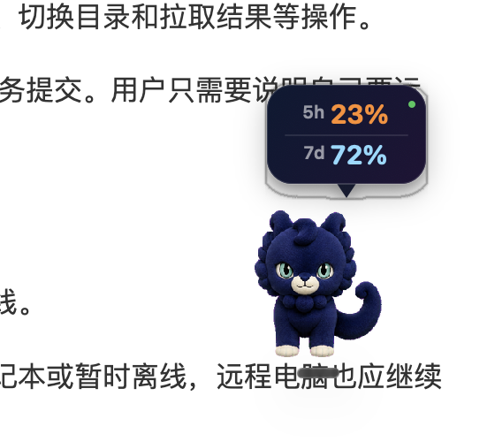

# Codex Pet Usage Bubble

A tiny macOS overlay that follows the floating pet in the ChatGPT desktop app and shows the real remaining Codex usage for the five-hour and weekly windows.



## Features

- Displays the real remaining five-hour and weekly Codex allowances.
- Refreshes every five seconds through the local authenticated Codex service.
- Follows the floating pet every 0.1 seconds across apps and displays.
- Appears and disappears with the pet.
- Runs silently without using menu bar space.
- Starts automatically at login.
- Reconnects after timeouts and discovers the Codex runtime after app updates.
- Does not read, copy, log, or store authentication tokens.

## Requirements

- macOS 13 or later.
- The ChatGPT desktop app with a floating pet enabled.
- Xcode Command Line Tools. Install them with `xcode-select --install` if needed.

## Install

```bash
git clone https://github.com/Error404NotFound1/codex-pet-usage-bubble.git
cd codex-pet-usage-bubble
./scripts/install.sh
```

Then show your pet from **ChatGPT → Settings → Pets** or with `/pet`. The bubble appears above the pet automatically.

The installer builds the native Swift app locally, copies it to `~/Applications`, and creates a per-user LaunchAgent.

## Update

```bash
git pull
./scripts/install.sh
```

## Uninstall

```bash
./scripts/uninstall.sh
```

The uninstaller stops the service and moves the installed app and LaunchAgent to Trash.

## How it works

The app launches the Codex service bundled with the ChatGPT desktop app and requests `account/rateLimits/read` every five seconds. It converts the returned used percentages into remaining percentages. Pet visibility and the saved overlay position are read from local ChatGPT state; the bubble is a click-through native `NSPanel` positioned above the pet.

No network requests are made directly by this app. Account access remains inside the locally authenticated Codex service.

## Compatibility note

`account/rateLimits/read` and the desktop pet overlay state are internal ChatGPT desktop interfaces. They may change in future app updates. Runtime path discovery, response watchdogs, and automatic reconnection cover known update patterns, but a future protocol change may require a project update.

## Development

```bash
./scripts/build.sh
open "build/Pet Usage Bubble.app"
```

The project intentionally uses AppKit and Foundation only; there are no third-party dependencies.

## License

MIT
