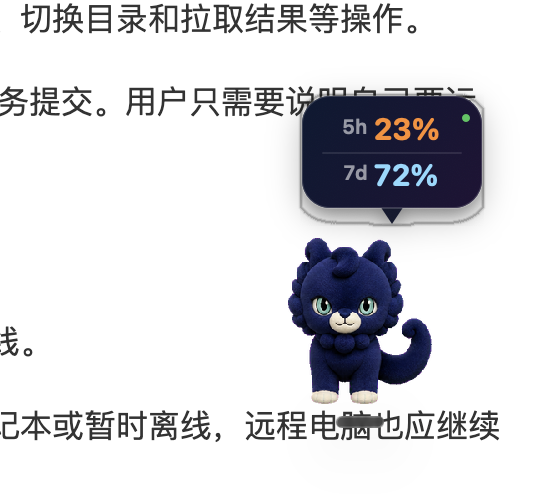

# Codex 宠物用量气泡

一个轻量 macOS 原生悬浮气泡，自动跟随 ChatGPT 桌面宠物，显示真实的 Codex 5 小时和每周剩余用量。



## 功能

- 每 5 秒读取一次真实额度。
- 每 0.1 秒跟随宠物跨应用、跨显示器移动。
- 与宠物同步显示和隐藏。
- 静默后台运行，不占用菜单栏。
- 登录后自动启动。
- 服务无响应或 ChatGPT 更新后自动重连。
- 不读取、复制、记录或保存登录令牌。

## 环境要求

- macOS 13 或更高版本。
- 已安装 ChatGPT 桌面应用，并启用浮动宠物。
- Xcode Command Line Tools；缺少时运行 `xcode-select --install`。

## 安装

```bash
git clone https://github.com/Error404NotFound1/codex-pet-usage-bubble.git
cd codex-pet-usage-bubble
./scripts/install.sh
```

在 **ChatGPT → 设置 → 宠物** 或通过 `/pet` 显示宠物，气泡会自动出现在宠物头顶。

安装脚本会在本机编译 Swift 应用，复制到 `~/Applications`，并创建当前用户的自启动服务。

## 更新

```bash
git pull
./scripts/install.sh
```

## 卸载

```bash
./scripts/uninstall.sh
```

卸载脚本会停止服务，并将应用和自启动配置移动到废纸篓。

## 原理与隐私

应用调用 ChatGPT 桌面端自带的 Codex 本地服务，每 5 秒请求一次 `account/rateLimits/read`，再把接口返回的已用比例换算为剩余比例。气泡通过本地宠物显示状态和位置自动定位。

应用自身不会直接发起网络请求，账户访问由已经登录的 Codex 本地服务完成。

## 兼容性说明

用量接口和宠物悬浮状态属于 ChatGPT 桌面端内部接口，未来更新可能发生变化。项目已经包含运行时路径发现、无响应监测和自动重连机制。

## 许可证

MIT
